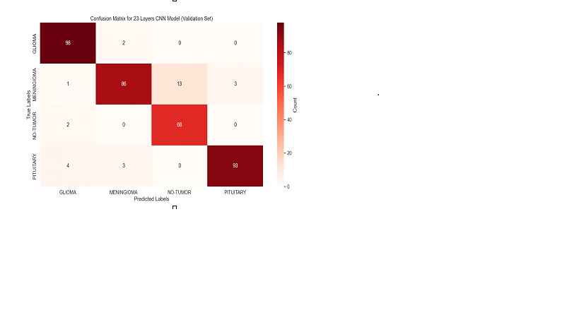
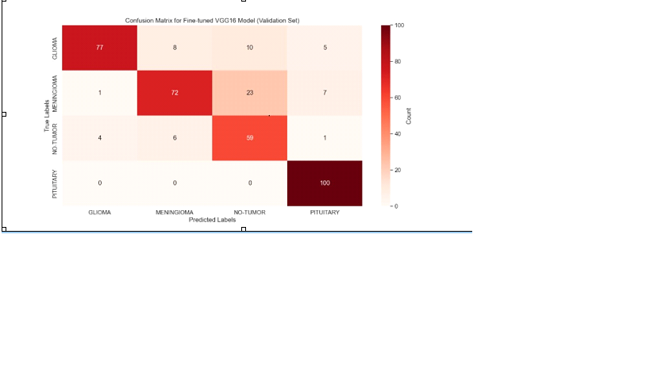

# Brain Tumor Classification using CNN

Final year project: classifying brain MRI images into tumor types using a custom CNN and a fine-tuned VGG16 model.

## Dataset
Brain tumor MRI images (Glioma, etc.), not included in this repo due to size. Download from: <add your dataset link>

## Models
- Custom CNN (40 epochs)
- Fine-tuned VGG16 (40 epochs)

## Results

## Tech Stack
Python, TensorFlow/Keras, NumPy, Matplotlib, Scikit-learn

## Author
Nimra Shahab
